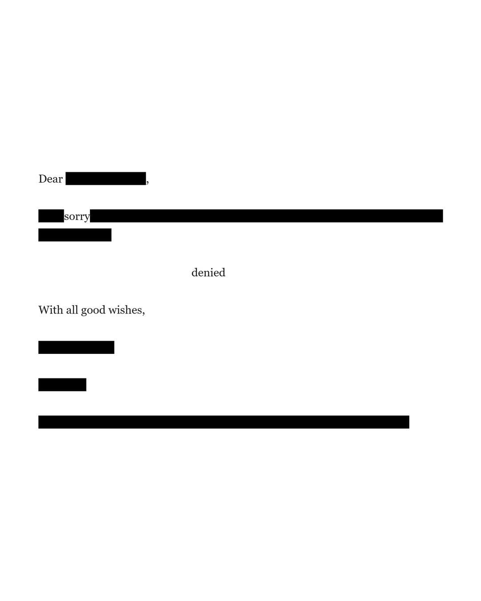

# weregrettoinform.you

Creatively processing rejection through computationally driven conceptual writing practices

## overview

Rejection is a normal part of life, particularly for artists. While most applications (for a fellowship, grant, job, etc.) are met with a denial, it is exhausting to receive a constant stream of "no's."

I've spent a lot of time this fall submitting applications. The torrent of rejections that followed made me look for a creative outlet to process this experience. At the same time, I couldn't help but notice a recurring pattern in these often polite, but ultimately impersonal, denial emails I was receiving. How many of them were even written by an actual person? Why am I spending so much time reading them? This is clearly a job for a computer.

Over the last decade I have been teaching myself natural language processing (primarily via the Python project [NLTK](https://www.nltk.org/)) in order to work with language as a structurally significant material in my instruction-based performance work (my training is in music composition so I use the term "scores" here). This exploration has led to a growing body of tools for a series of operas as well as images and arrangements of text inspired by conceptual writing practices. weregrettoinform.you is an opportunity to channel the energy of "no's" into something creative that simultaneously supports prototyping new methods for processing / transforming language.

The software keeps the shape of the original email and leaves words it identifies as negative visible. The rest of the body text disappears or is covered with black boxes.

## pipeline

The software currently:

1. ingests rejection emails (manually) exported as `.eml` files
2. extracts the email body from HTML
3. detects a loose structure: salutation, body, valediction
4. uses NLTK's VADER lexicon to detect negative words, which remain visible in the body text
5. uses the previous analysis to transform the remaining text (ex: renders words invisible, covers words with a black box,  or randomly alternates between the two etc.)
6. renders local images intended to be shared on Instagram as PNGs

## structure

The salutation is treated as the project's structural anchor. A paragraph containing a greeting word and (my) name denotes the beginning of the rejection. The name is then treated as private text and "redacted" (blocked out).

The primary focus of this project is transforming/processing the body text, obscuring private information, and maintaining the overall structure of an email/letter. It is important that the overall shape of the message is preserved without exposing or calling out an organization or person.

The body text can be handled in three different ways. In `blocked` text is covered with a black box. In `whitespace` text stays in place but is rendered invisible. In `both` the software alternates between those two states in runs (rather than word by word). A percentage influences the mix of the two states: 0% makes all text invisible, 100% makes all text blocked, and 50% results in a roughly equal balance between the two. Negative words and paragraph breaks act as boundaries. Each render is random and expects a user to deny (triggering a refresh) or approve the result.

The valediction is the most unstable part of this structure. Some rejections have them, some don't, and the variety of forms they take is extreme. Nonetheless, the software searches for a sign-off of some sort (ex: "Best, [NAME]") to denote the end of the rejection.

When a sign-off and an identifying name or organization can be found together the sign-off phrase is preserved and everything after it is blocked. If that relationship is uncertain the entire valediction is blocked.

## commands

List available source emails:

```
uv run weregrettoinform --list
```

Render one email:

```
uv run weregrettoinform --email <filename> --transform blocked
uv run weregrettoinform --email <filename> --transform whitespace
uv run weregrettoinform --email <filename> --transform both
uv run weregrettoinform --email <filename> --transform both --both-proportion 50
```

`<filename>` can be the full source filename or enough of it to identify one email.

The `both` transform opens a local candidate HTML and asks for approval. Answering no produces a fresh random version. `--both-proportion` accepts values from 0 to 100 and defaults to 50. The HTML contains the original text and remains local only; approved PNGs are meant to be shared.

## example


