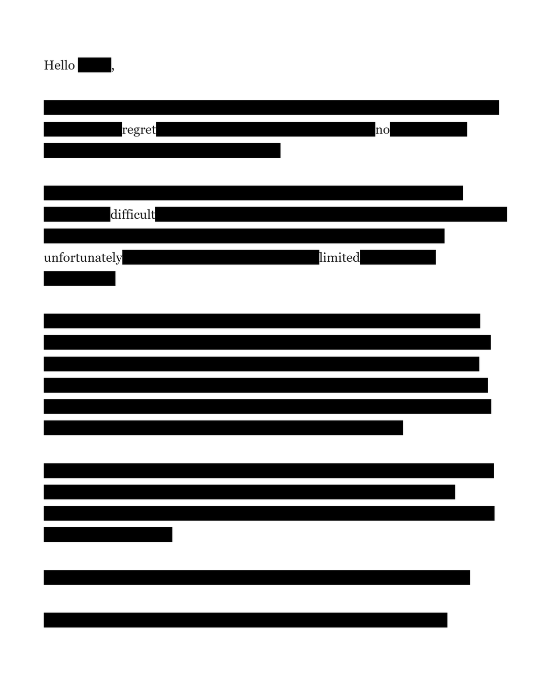

# weregrettoinform.you

Creatively managing rejection through computationally driven conceptual writing practices

## overview

Rejection is a normal part of life, particularly for artists. While most applications (for a fellowship, grant, job, etc.) are met with a denial, it is tiresome to receive a constant stream of "no's" for a sustained period of time.

After a particularly active Fall submitting as many applications as possible, and a torrent of rejections, I began to search for a creative outlet to process this experience. At the same time, I couldn't help but notice a recurring pattern in these often polite, but ultimately impersonal, denials I was receiving. How many of them were even written by an actual person? Why am I spending so much time reading them? This is clearly a job for a computer.

Over the last decade I have been teaching myself Natural Language Processing (primarily via the Python project [NLTK](https://www.nltk.org/)) in order to work with language as a structurally significant material in my instruction-based performance work (my training is in Music Composition so I use the term "scores" here). This exploration has resulted in a growing body of tools for a series of operas and also produces striking images/arrangements of text inspired by conceptual writing practices. weregrettoinform.you is an opportunity to channel the energy of "no's" into something creative that simultaneously supports prototyping new methods for processing / transforming language.

## pipeline

The software currently:

1. ingests rejection emails (manually) exported as `.eml` files
2. extracts the email body from HTML
3. detects a loose structure: salutation, body, valediction
4. uses various NLTK tools to analyze and process the text
5. transforms/styles that text via various procedures (ex: renders words invisible, covers words with a black box, etc.)
6. renders local images intended to be shared on Instagram as PNGs

## structure

The salutation is treated as the project's structural anchor. A paragraph containing a greeting word and (my) name denotes the beginning of the rejection. The name is then treated as private text and "redacted" (blocked out).

The primary focus of this project is transforming/processing the body text, obscuring private information, and maintaining the overall structure of an email/letter. It is important that the overall shape of the message is preserved without exposing or calling out an organization or person.

The valediction is the most unstable part of this structure. Some rejections have them, some don't, and the variety of forms they take is extreme. Nonetheless, the software searches for a sign-off of some sort (ex: "Best, [NAME]") to denote the end of the rejection.

## commands

List available source emails:

```
uv run weregrettoinform --list
```

Render one email:

```
uv run weregrettoinform --email <filename> --transform blocked
uv run weregrettoinform --email <filename> --transform whitespace
```

## example


